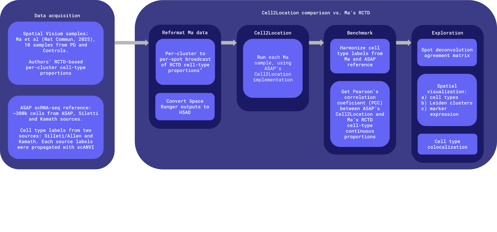

# reference_building/benchmark/

Benchmarks this repo's Cell2Location deconvolution pipeline against Ma et al.
2025 (*Nat Commun*) — 10 human substantia nigra Visium sections with
published RCTD/BayesSpace cell-type proportions.

**Caveat:** Ma et al.'s RCTD proportions are aggregated per-BayesSpace-cluster means, not true per-spot values — every spot sharing a cluster gets an identical proportion vector. See `03_build_benchmark.py`'s docstring.

## Workflow

Fetches Ma et al.'s public data, reformats it alongside this repo's own
Visium samples, runs Cell2Location, then compares the two sets of per-spot
cell-type calls.

This is a one-time benchmarking analysis, not part of the spatial
deconvolution WDL pipeline.



See slides for full analysis context: [Cell2Location vs Ma (RCTD) overview](https://docs.google.com/presentation/d/1NrLuYe5S31BgBTzDqgeqwHes8uX3g8db5uUCJzg6Jec/edit).

## Reference-building strategies

Cell2Location was benchmarked against three different sc-RNA-seq reference
strategies (see `notebooks/compare_reference.ipynb` for the interactive
side-by-side comparison).

### Strategy 1
* Motivation: Build a temporary reference with `sc-rnaseq-wf` v3.1.0 cells while v5.0.0 was being developed.
* File: `deconvolution_reference_300k_c2lUda_Kamath200Rand.h5ad`.
* Generated with: `downsample_kamath_menon_siletti_asap.py`, then `integrate_kamath_menon_siletti_asap.py`.
* Reference integration logic: used scVI+scANVI with parameters similar to the `sc-rnaseq-wf` v5.0.0 pipeline. Here, only cells listed below were used--not the whole ASAP cohort--and used scANVI-propagated Kamath labels for training.
* Cells included:
  * ASAP cells: 100k random from sc-rnaseq-wf workflow v3.1.0.
  * Siletti cells: 100k — all ~805 DA VGLUT2 cells, then top-up random from all cell types.
  * Kamath cells: 100k — a 200-cell-floor-per-type + random top-up sample (only 6,530 out of 22,048 Kamath's DA's).

### Strategy 2
* Motivation: In general, Strategy 1 worked well, but it included 20% ASAP cells that passed QC in sc-rnaseq-wf v3.1.0 and were filtered out in sc-rnaseq-wf v5.0.0. Hence, strategies 2 and 3 used cells from the v5.0.0 workflow. Strategy 2 used the `sc-rnaseq-wf` inferred Siletti/Allen cell type labels (not Kamath's like Strategy 1).
* File: `deconvolution_reference_asap200k_kamathAllDAUnCollapsed_Siletti100k.h5ad`
* Generated with: `build_deconv_reference_h5ad.py -i build_reference_h5ad_asap200k_kamathAllDAUnCollapsed_Siletti100k.json`.
* Reference integration logic: all cells came from the `sc-rnaseq-wf` v5.0.0 pipeline (ASAP + Siletti/Kamath spike-ins). The pipeline's `C_scANVI` label, which was trained with Siletti/Allen labels, was used for Cell2Location training.
* Cells included:
  * ASAP cells: 200k random.
  * Siletti cells: 100k random.
  * Kamath cells: all ~24k DA only (no other cell types — `sc-rnaseq-wf` only spikes in Kamath's DA population).

### Strategy 3
* Motivation: Use `sc-rnaseq-wf` v5.0.0 cells and improve the cell type coverage (i.e. make it similar to strategy 1).
* File: `deconvolution_reference_strategy3.h5ad`
* Generated with `downsample_kamath_siletti_asap_strategy3.py`.
* Integration logic: like strategy 2, used ASAP cells labeled with `sc-rnaseq-wf`'s v5.0.0 `C_scANVI`; Siletti cells keep their original Allen labels (not those produced by `sc-rnaseq-wf`); Kamath cells harmonized into Siletti/Allen-space column via `utils/cell_type_maps.py`'s `KAMATH_TO_SILETTI_ALLEN`.
* Cells included:
  * ASAP cells: 100k, re-identified/topped-up from v5.0.0 — 68,113 barcode-remapped from Strategy 1's ASAP cells, + 11,062 native-ASAP DA top-up, + 20,825 random fill.
  * Siletti cells: 99,553, exact same cells as Strategy 1; native Siletti/Allen `supercluster_term` label.
  * Kamath cells: 99,329, exact same cells as Strategy 1 (only 6,530 out of 22,048 Kamath's DA's).

### Mapping barcodes between release v3.1.0 (Strategy 1) and v5.0.0 (Strategies >= 2)
```
==> v3.1.0 <==
TTGAACGGTGCCTACG-1_ASAP_PMBDS_000038_s001_Rep1.cleaned_unfiltered.h5ad
AGCGCTGTCTAACGGT-1_ASAP_PMBDS_000038_s001_Rep1.cleaned_unfiltered.h5ad
==> v5.0.0 <==
CTAGTGACAATCTACG-1_DS_PMDBS_0001.ASAP_PMDBS_000002_s002_BiolRep1_0
GATGCTAGTAACGCGA-1_DS_PMDBS_0001.ASAP_PMDBS_000002_s002_BiolRep1_0
```
* See `reference_building/benchmark/asap_barcode_mapping_v3_vs_v5/all_v3.1.0_barcodes_in_final/asap_barcode_mapping_v3_vs_v5.log`

The `5.0.0/2026-10-19T14-59-48Z/asap-cohort.final_metadata.csv.gz` file has three cell type columns:

|obs_column |source |comment |
|:----|:----|:----|
| cell_type | v5.0.0 MMC. Includes 5,390 ASAP `Dopaminergic` cells. | README says "mapped to an ABC Atlas taxonomy" -- It was the Siletti/Allen one, see [README Notes](https://mail.google.com/mail/u/0/#search/ktrimble%40michaeljfox.org/QgrcJHsHqfmfcXhjkgLvjqbnRvHtMqTZPzB)|
| C_scANVI | v5.0.0 scANVI. No more `Dopaminergic` cells, instead most (~82%) are DA subtypes (e.g. SOX6_AGTR1) and `Splatter` (16%). | The `Dopaminergic` label was assined DA subtypes by scANVI's |
| cell_type_scanvi | `spatial-sc-rnaseq-integration-wf/reference_building/da_neurons_identification_analysis` | If still possible, it may be better to remove from- or rename in `asap-cohort.final*` |

### Difference in proportions of DA subtypes between ASAP and Kamath datasets
In the table below:
* `ASAP 5.0.0`: number and percent of all ASAP cells labeled as DA subtypes in sc-rnaseq-wf v5.0.0 C_scANVI
* `Kamath 200`: number and percent of Kamath cells used in Strategy 1 (at least 200 cells per cell type)
* `Kamath 200`: number and percent of all Kamath cells (file `kamath_merged_da_all_non_da_13000_preQC.h5ad`)
* SOX6_DDT+SOX6_AGTR1 alone make up 88% in ASAP vs. ~49% in Kamath's true distribution
* SOX6_DDT is 4x higher in ASAP than in Kamath
* CALB1_* subtypes nearly disappeare in ASAP

| subtype | n ASAP 5.0.0 | Kamath 200 | Kamath all |
|:---|:---|:---|:---|
| SOX6_AGTR1 | 4975 (43.6%) | 2096 (32.1%) | 8498 (38.5%) |
| SOX6_PART1 | 173 (1.5%) | 765 (11.7%) | 2646 (12.0%) |
| CALB1_CALCR | 685 (6.0%) | 699 (10.7%) | 2479 (11.2%) |
| SOX6_DDT | **_5108 (44.8%)_** | 710 (10.9%) | 2414 (10.9%) |
| SOX6_GFRA2 | 376 (3.3%) | 517 (7.9%) | 1589 (7.2%) |
| CALB1_PPP1R17 | 39 (0.3%) | 467 (7.2%) | 1358 (6.2%) |
| CALB1_CRYM_CCDC68 | 3 (0.0%) | 357 (5.5%) | 931 (4.2%) |
| CALB1_GEM | 21 (0.2%) | 340 (5.2%) | 884 (4.0%) |
| CALB1_RBP4 | 17 (0.1%) | 318 (4.9%) | 763 (3.5%) |
| CALB1_TRHR | 9 (0.1%) | 261 (4.0%) | 486 (2.2%) |
| **Total** | **11406 (100.0%)** | **6530 (100.0%)** | **22048 (100.0%)** |

## Summary
* As shown in `notebooks/compare_reference.ipynb`, both Strategies 1 and 3 worked better than Strategy 2.
* **Hence, Strategy 3 was used for the Production run with ASAP Visium spatial samples.**

## Directory contents, inputs, and outputs (StrategyN = reference building strategy number {1-3})

| Path | What | Inputs | Key outputs |
|---|---|---|---|
| `scripts/01_fetch_al_dalahmah_zenodo_data.py` | Step 1. Fetch the two Zenodo artifacts needed for the benchmark | Zenodo records 19454950 / 19457732 (network) | `data/original/{processed_st_obj.rds, 41467_2025_62478_MOESM3_ESM.xlsx}` |
| `scripts/02_export_spot_metadata.R` | Step 2. Export per-spot Region/Condition/BayesSpace-cluster metadata from the Seurat object list | `data/original/processed_st_obj.rds` (step 1) | `data/reformatted/spot_metadata_all_samples.csv.gz` |
| `scripts/03_build_benchmark.py` | Step 3. Join spot metadata to Supplementary Data 1's per-cluster RCTD proportions | Spot metadata (step 2) + Supplementary Data 1 xlsx (step 1) | `data/reformatted/per_spot_benchmark_al_dalahmah_sn.csv.gz` |
| `scripts/04_plot_sn_dopa_gaba_meg3_pd_vs_control.py` | Step 4. (Optional) Standalone exploratory PD-vs-control stats/plots on the RCTD benchmark (not required for steps 5-7) | Benchmark table (step 3) | `data/analysis/*.html` |
| `scripts/05_format_visium_for_cell2location.py` | Step 5. Convert each sample's Space Ranger `outs/` zip into a Cell2Location-ready h5ad | `data/original/*_result-*.zip` | `data/reformatted/spatial_h5ad/<sample>.spatial.h5ad` |
| `scripts/06_submit_cell2location_RefStrategyN.sh` | Step 6. Run this repo's `cell2location_deconv.py` against StrategyN's reference — reference training once, then spatial mapping + clustering per sample | Spatial h5ads (step 5) + StrategyN reference h5ad | `data/reformatted/cell2location_StrategyN/<sample>.deconvoluted_clustered.h5ad` |
| `scripts/07_agreement_matrix_reference_RefStrategyN.py` | Step 7. Pool both sides into a shared cell-type vocabulary and compare as continuous proportions (PCC/RMSE/Jensen-Shannon) | StrategyN Cell2Location outputs (step 6) + benchmark table (step 3) | `data/reformatted/cell2location_StrategyN/asap_agreement_*.csv.gz` |
| `<repo_root>/notebooks/visualize_deconvolution.ipynb` | Interactive Jupyter notebook to explore a single strategy's benchmark analysis | Outputs from steps 06 and 07 (one strategy at a time) | Agreement matrix heatmap, detailed spatial plots |
| `<repo_root>/notebooks/compare_reference.ipynb` | Interactive Jupyter notebook comparing all 3 strategies side by side | Outputs from steps 06 and 07 (all 3 strategies) | Side-by-side agreement matrices, spatial plots, and per-spot agreement scatter |
| `docs/` | Workflow diagram and other supporting documentation assets. | — | — |
