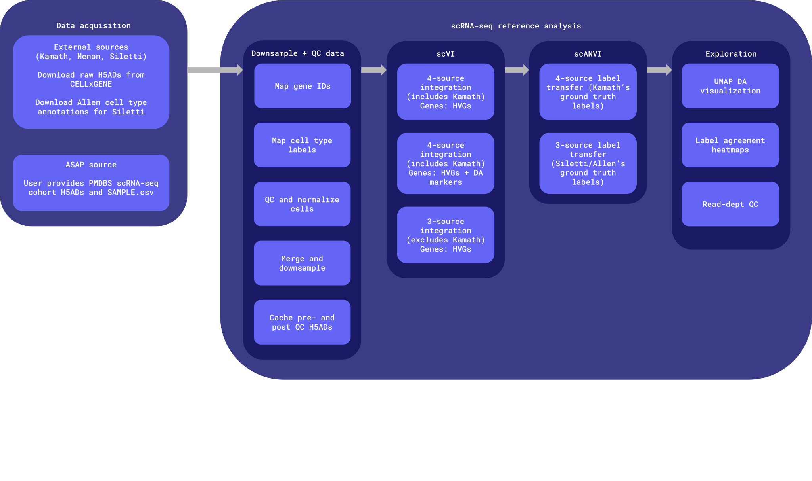

# reference_building/da_neurons_identification_analysis/

Builds a dopaminergic-neuron-focused scVI/scANVI reference by integrating up
to four snRNA-seq `sources` relevant to Parkinson's disease (PD):

- **[Kamath et al. 2022](https://pubmed.ncbi.nlm.nih.gov/35513515/)** (*Nat Neurosci*) — 22,048 FANS-enriched dopaminergic neurons (DA) and other cell types.
- **[Siletti et al. 2023](https://pubmed.ncbi.nlm.nih.gov/37824663/)** (*Science*) — whole-brain atlas; only the 3
  midbrain dissections are used. Cell type annotations used for benchmark come from the Allen
  Brain Cell Atlas.
- **[Menon et al. 2026](https://www.biorxiv.org/content/10.64898/2026.03.05.709922v1)** (bioRxiv) — ~4.5M nuclei across 5 brain regions;
  only substantia nigra is used here.
- **[ASAP PMDBS cohort](https://cloud.parkinsonsroadmap.org/collections/prod-cohort-pmdbs-sc-rnaseq/overview)** — sourced from sc-rnaseq-wf's unfiltered H5AD.
- See `sources.pdf` for details of sources and downsampled cells.

## Workflow
The `da_neurons_identification_analysis` workflow downloads, downsamples and integrates the sources above
using scVI/scANVI and cell type labels from either Kamath or Siletti for training.

This is a one-time analysis, not part of the spatial deconvolution WDL pipeline.




## Directory contents, inputs, and outputs

| Path | What | Inputs | Key outputs |
|---|---|---|---|
| `scripts/01_download_kamath_menon_siletti.py` | Download H5ADs from CELLxGENE | CELLxGENE API (network) — Kamath/Menon/Siletti collections | `reference_data/{source}/*.h5ad` |
| `scripts/02_kamath_overlap.py` | One-time pre-downsample of Kamath H5ADs to identify files relevant for integration. | `reference_data/kamath/*.h5ad` (9 raw files) | None — prints results to console only |
| `scripts/03_downsample_kamath_menon_siletti_asap.py` | Downsample and QC datasets | `reference_data/{source}/*.h5ad` (step 1); ASAP H5ADs `merged_cleaned_unfiltered.h5ad` & `final.h5ad`, and `SAMPLE.csv` (hardcoded paths — must be provided by user, not downloaded by any script); Allen Brain Cell Atlas metadata (manually downloaded) | `reference_data/*/intermediate/*_{preQC,postQC}.h5ad`|
| `scripts/04_integrate_kamath_menon_siletti_asap.py` | All four sources included. Uses Kamath cell type labels as ground-truth | All 4 sources' either preQC or postQC H5AD caches (step 2) | Final `output/{suffix}/integrated_{suffix}.h5ad`. See [Integration outputs](#integration-outputs) for details.|
| `scripts/05_integrate_menon_siletti_asap.py` | Three sources included (Kamath excluded). Same logic as above but using Siletti (Allen) labels as ground-truth. | Menon/Siletti/ASAP preQC or postQC H5AD caches (step 2) | Same as above but with `{suffix}_no_kamath`. |
| `utils/_reference_building_utils.py` | Shared functions and constants used by scripts above. | — | — |
| `<repo_root>/notebooks/explore_integration.*.ipynb` | Interactive Jupyter notebooks to explore scRNA-seq integration outputs | Outputs from integration steps 04 and 05 | UMAP explorer, label agreement, read-depth QC |
| `<repo-root>/scripts/build_deconv_reference_h5ad.py` | Build a scRNA-seq reference for the decovolution. | ASAP, Siletti and Kamath integrated and pre-QC H5ADs | Final reference H5AD |
| `reference_data/allen-brain-cell-atlas/` | Manually-downloaded Allen Brain Cell Atlas reference files (see its own `README.md`). | — | — |
| `output/` | See [Integration outputs](#integration-outputs) for details. | — | — |
| `docs/` | Workflow diagram and other supporting documentation assets. | — | — |


scripts/build_deconv_reference_h5ad.py

## How to submit

- For each source, `03_downsample_kamath_menon_siletti_asap.py` makes preQC and postQC files addressing dataset-specific downsampling and QC strategies. See `sources.pdf`.
- Steps 1 & 2 are CPU-only and run once per set of downsampling targets. Step 3 is GPU-bound and re-loads whatever step 2 cached (it never re-derives QC or downsampling).
- Typically, steps 2 and 3 share the same `{downsampling-parameters}` to identify cached files, like:     
`--kamath-non-da-per-type 13000 --downsample-menon 100000 --siletti-scale 100000 --downsample-asap-cohort 100000`

### Submission examples:
```
python3 /path/to/01_download_kamath_menon_siletti.py
python3 /path/to/03_downsample_kamath_menon_siletti_asap.py {downsampling-parameters}
python3 /path/to/04_integrate_kamath_menon_siletti_asap.py  {downsampling-parameters} --gene-selection hvg_u_da_markers --output-dir /path/to/outdir
```

## Step 3 notes

### `--gene-selection` for scVI/scANVI training

Controls which genes scVI/scANVI actually train on. Highly Variable Genes (HVGs) are always computed regardless, for reference:

| Value | Training genes |
|---|---|
| `gene_intersection` (default) | All genes shared by the inner join across sources — no restriction. |
| `hvg_only` | Just the `--n-hvgs` HVGs (Pearson residuals, matching sc-rnaseq-wf's own `cohort_analysis` process task). |
| `hvg_u_da_markers` | HVGs ∪ the 17 Kamath DA marker genes. |
| `list` | Exactly the Ensembl gene IDs in `--infile-gene-selection` (one per line). For controlled A/B comparisons (e.g. a marker-ablation panel). |

### Marker-ablation study: Kamath data × Kamath DA markers

A 2×2 design crossing whether Kamath's cells are in the training data against whether the
17 Kamath DA marker genes are in the scVI/scANVI training panel. Each `list`-mode gene file
is that condition's own `hvg_u_da_markers` panel with the 17 markers subtracted out --
markers still get added back into the *saved* H5AD regardless (see the `list` row above),
so they stay plottable even in the two "markers: no" runs.

```
Kamath data?
│
├── YES  (04_integrate_kamath_menon_siletti_asap.py)
│   │
│   ├── Kamath markers: YES  --gene-selection hvg_u_da_markers
│   │   └── output/asap96k_kamath97k_menon99k_siletti100k_hvg_u_da_markers/
│   │
│   └── Kamath markers: NO   --gene-selection list
│       │                    --infile-gene-selection reference_data/gene_lists/asap96k_kamath97k_menon99k_siletti100k_hvg_minus_da_markers_gene_list.txt
│       └── output/asap96k_kamath97k_menon99k_siletti100k_list_asap96k_kamath97k_menon99k_siletti100k_hvg_minus_da_markers_gene_list/
│
└── NO   (05_integrate_menon_siletti_asap.py -- Kamath never loaded)
    │
    ├── Kamath markers: YES  --gene-selection hvg_u_da_markers
    │   └── output/asap96k_menon99k_siletti100k_hvg_u_da_markers_no_kamath/
    │
    └── Kamath markers: NO   --gene-selection list
                             --infile-gene-selection reference_data/gene_lists/asap96k_menon99k_siletti100k_hvg_minus_da_markers_gene_list_no_kamath.txt
        └── output/asap96k_menon99k_siletti100k_list_asap96k_menon99k_siletti100k_hvg_minus_da_markers_gene_list_no_kamath_no_kamath/
```

Each `*_gene_list[_no_kamath].txt` is derived from that same branch's own `hvg_u_da_markers`
run (its saved H5AD's `var_names` *is* its training panel in that mode) minus the 17 DA
marker Ensembl IDs, resolved via Menon's `var['feature_name']` -- not shared across branches,
since HVG selection depends on which sources are present.

**Caveat:** the first "Kamath data: NO, markers: NO" run actually completed used
`reference_data/gene_lists/asap96k_kamath97k_menon99k_siletti100k_hvg_minus_da_markers_gene_list.txt` (the Kamath
branch's HVG basis) instead of the no-Kamath-native file shown above -- its output folder is
`asap96k_menon99k_siletti100k_list_asap96k_kamath97k_menon99k_siletti100k_hvg_minus_da_markers_gene_list_no_kamath/`.
That's Kamath-free *training data* on a Kamath-influenced *gene basis* -- still a valid
comparison, just not the same as the clean no-Kamath-anywhere cell in this 2×2. Re-run with
the no-Kamath-native list above for a strict version.

### Integration outputs

Each step 3 `integrate_*py` run gets its own `{suffix}` subfolder under `--output-dir`, named from the post-merge cell counts and `--gene-selection` parameters, like:

```
{source1}{N1}k_{source2}{N2}k_..._{gene_selection_tag}[_no_kamath]/

Examples:
asap96k_kamath97k_menon99k_siletti100k_hvg_u_da_markers/ # ~100k cells per source, using HVG's ∪ DA markers for scVI/scANVI training
asap96k_menon99k_siletti100k_hvg_u_da_markers_no_kamath/ # like above, but excluding Kamath's measurements and labels
```
with contents:
```
output/{suffix}/
├── integrated_{suffix}.h5ad # The integrated AnnData.
├── <scvi|scanvi>_model/     # Saved scvi-tools models.
├── elbo_convergence.png     # Train/val ELBO curves, best epoch marked.
├── timing.tsv               # Time log for each integration step.
└── {script_stem}.log        # Full stdout/stderr capture for that run.
```

### `obs` columns in `integrated_{suffix}.h5ad`

#### Shared columns (all cells, all variants)

| Column | Values |
|---|---|
| `source` | `'kamath'` (4-source only), `'menon'`, `'siletti'`, `'asap_cohort'` |
| `batch` | scVI batch key: `'kamath_{donor_id}'` / `'menon_{donor_id}_{region}'` / `'siletti_{sample_id}'` / `'asap_{team}_{dataset}_{sample}'` |
| `condition_id` | PD / Prodromal / Control / Other — harmonized across all sources from ASAP's own `SAMPLE.csv` |
| `doublet_score` | From `_apply_qc_filters` (scrublet), all sources |
| `cell_type_scanvi` | **Training input to scANVI** — Either Kamath's CELLxGENE H5AD column `author_cell_type` or Siletti's `siletti_allen_cluster` derived from the Allen Brain Cell Atlas metadata. |
| `cell_type_pred` | **scANVI's predicted output** — For cells that had a `cell_type_scanvi` input label, this should mostly match it; for every other cell, it's the transferred label. |
| `da_subtype` | 4-source script only: fine-grained DA subtype (e.g. `SOX6_AGTR1`) for Kamath cells and transferred DA calls. |
| `_scvi_batch`/`_scvi_labels` | scvi-tools-internal categorical codes.

#### Source-specific columns

| Column | Source | Description |
|---|---|---|
| `menon_cell_type` | Menon | Menon's own CELLxGENE `cell_type` (Cell Ontology term, e.g. `oligodendrocyte`). Post-hoc agreement checking only, never used for training. |
| `menon_author_cell_type` | Menon | Menon's own coarse `author_cell_type` (e.g. `Oligo`, `Dopaminergic`). |
| `siletti_cxg_cell_type` | Siletti | Siletti's CELLxGENE deposit `cell_type`. Not used because it doesn't have "dopaminergic neuron" — see `siletti_allen_da_vglut2`. |
| `siletti_cxg_author_cell_type` | Siletti | Siletti's CELLxGENE deposit `supercluster_term`. |
| `siletti_cxg_region` | Siletti | Which of the 3 midbrain dissections (`SN-RN`, `SN`, `RN`). |
| `siletti_allen_da_vglut2` | Siletti | **Not from Siletti's CELLxGENE deposit** — cross-referenced by barcode from the Allen Brain Cell Atlas. `True`/`False` boolean. |
| `siletti_allen_neurotransmitter` | Siletti | Allen's neurotransmitter-level term (`DA VGLUT2`, `GABA`, `VGLUT1 VGLUT2`, `None`, etc. — 16 distinct values). |
| `siletti_allen_subcluster` | Siletti | Allen's finest-level taxonomy label (~900 distinct values). Used to derive `siletti_allen_cluster` (e.g. `Splat_395` corresponding to `DA VGLUT2`)|
| `pmdbs_sc_rnaseq.C_scANVI` | ASAP | scANVI-propagated labels from the upstream `pmdbs_sc_rnaseq` pipeline. |
| `pmdbs_sc_rnaseq.cell_type` | ASAP | MMC / Allen Brain Atlas labels from the upstream `pmdbs_sc_rnaseq` pipeline. |
